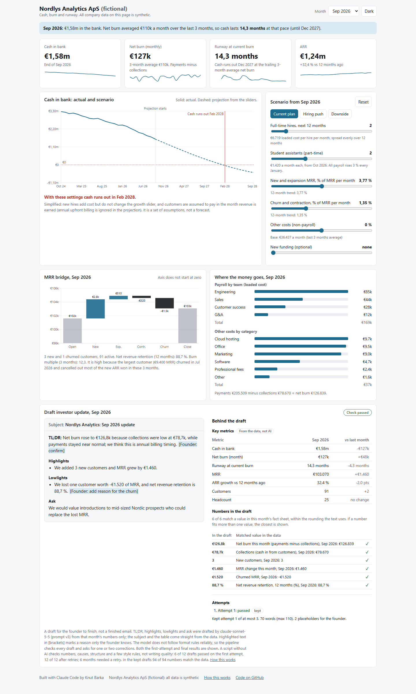

# Startup runway dashboard: Nordlys Analytics ApS (fictional)

A cash, burn and runway dashboard for a fictional Danish SaaS startup, with AI-drafted investor updates that a script checks.

**Live site:** LIVE_URL_PLACEHOLDER

> **All data in this project is fictional.** Nordlys Analytics ApS does not exist. A script generated every customer, employee, cost and cash figure. Customer names are built from invented word parts, so any match with a real company is a coincidence.



## The problem

Every month a startup founder has to know how much cash is left, how fast it is going and how long it will last. Investors then want a short update on what changed. This project answers both for one fictional company, and every number can be traced to one SQL file.

## What the dashboard shows

- **Four KPIs** for the selected month: cash in bank, net burn, runway at current burn and ARR. In Sep 2026 the company has €1.579.630 in the bank, 14,3 months of runway (cash runs out in Dec 2027 at current burn) and ARR of €1.236.840.
- **A cash chart** with 24 months of actual cash and a 24-month projection. Sliders change hires, student assistants, growth, churn, other costs and new funding. Three presets set them all at once. With the default preset (Current plan) cash runs out in Feb 2028. The projection is a set of assumptions, not a forecast.
- **An MRR bridge** and a breakdown of where the money goes for the selected month.
- **A draft investor update** for each month from Oct 2025 to Sep 2026, with the result of its check.
- **A "How this works" page** with definitions, method, check results and limitations.

The data has a story built in: a hiring push in spring 2026, the largest customer leaving in Jul 2026, a price rise on new contracts from Jun 2026 and a one-off recruiting fee in Apr 2026.

## How it is built

Python (standard library, `duckdb`, `anthropic`) generates the data, runs the checks and drafts the updates. DuckDB does every calculation, one SQL view per file in `sql/`. The website is Next.js with a static export, Recharts and plain CSS. It makes no API calls.

The data flow runs in one direction. `scripts/generate.py` writes synthetic CSVs with a fixed seed. `scripts/reconcile.py` checks them (8 of 8 PASS). `build_db.py` loads them into DuckDB, creates the views and exports one JSON file. The website reads only that file. The scenario sliders run in the browser, and a test checks that the TypeScript result equals a separate Python version within €1 a month. Each metric is defined in `docs/metrics.md`. Every assumption is in `docs/assumptions.md`.

```bash
python scripts/generate.py
python scripts/reconcile.py
python build_db.py
python scripts/check_scenario.py
cd web && npm install && npm test && npm run build
```

## The AI part and how it is checked

For each month a script builds a fact sheet from the SQL views, using only that month and earlier ones. A look-ahead test rebuilds the database without the later months and checks that the fact sheet is the same.

The subject line and the key metrics table come from SQL, not from AI. Claude (`claude-sonnet-5-5`, prompt v3) writes the rest: a short TL;DR, up to two highlights and two lowlights, and one ask. Python gives each number in two forms, exact and rounded, and the model must copy one of them. Earlier versions rounded wrongly, for example €55k for €55.811. When the data does not show a cause, the draft leaves a placeholder such as "[Founder: add reason]". The drafts are for a founder to finish.

A script without AI then checks each draft. Every number must match that month's data. Named causes must be visible in the data (a crude keyword list). It also checks structure, length and a few style rules.

If a draft fails, the script sends one follow-up that lists the failed checks, without the correct values. Each month gets at most two retries, and the last attempt is kept. This rule and a USD 2,00 cost cap were committed before the run, and the run was done once.

**Results for v3:** 6 of 12 drafts passed on the first attempt and 12 of 12 after retries. All 94 numbers in the kept drafts match the data. Total AI cost across v1 to v3 was about USD 0,28 (USD 0,2759 logged, plus one early call that crashed before it was logged).

The checker was revised twice, both times for false flags. Both changes are in `docs/decisions.md`.

## Limitations

- The data is synthetic. It is only as realistic as the assumptions behind it.
- Revenue equals MRR. There is no proration, VAT or payment timing.
- The projection keeps other costs flat apart from the slider. It treats collections as equal to revenue, so annual upfront billing is ignored. New hires do not change the growth rate.
- The checker tests numbers and format, not writing quality.
- The Sep 2026 update writes "-€1.520" with a minus sign and guesses "annual billing timing" as a cause.
- The Jul 2026 update has no full stop after two placeholders.
- The Apr 2026 TL;DR says costs are rising faster than revenue. That is an inference the checker cannot verify.
- 2 of the 6 retries were caused by false flags in the cause check ("Contraction MRR was €0", "churn was zero"). This was not fixed after the run.
- The rule that a planned hire is not a lowlight is only in the prompt. The checker does not test it.
- Each prompt version was run once. Variation between runs is not measured.

## Next version

- Load real exports (billing, payroll, bank) instead of the generator.
- A minimum cash buffer line instead of only €0.
- Run each prompt several times and measure how much the drafts vary.

## More detail

- [`docs/case-sheet.md`](docs/case-sheet.md): one-page summary of the project
- `docs/explain.md`: how everything works, with questions and answers
- `docs/decisions.md`: every choice made during the build, with the alternative

## Who built it

Built with Claude Code by Knut Barka, an economics student who builds finance tools with AI. [linkedin.com/in/knutbarka](https://www.linkedin.com/in/knutbarka)
